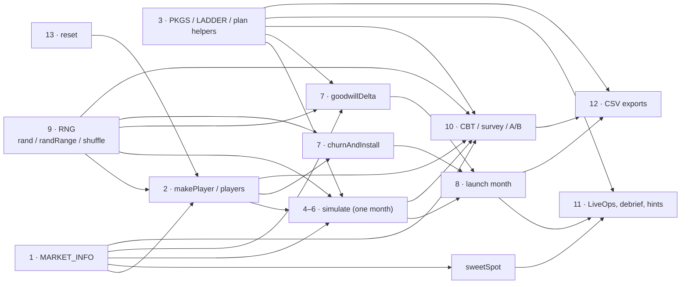
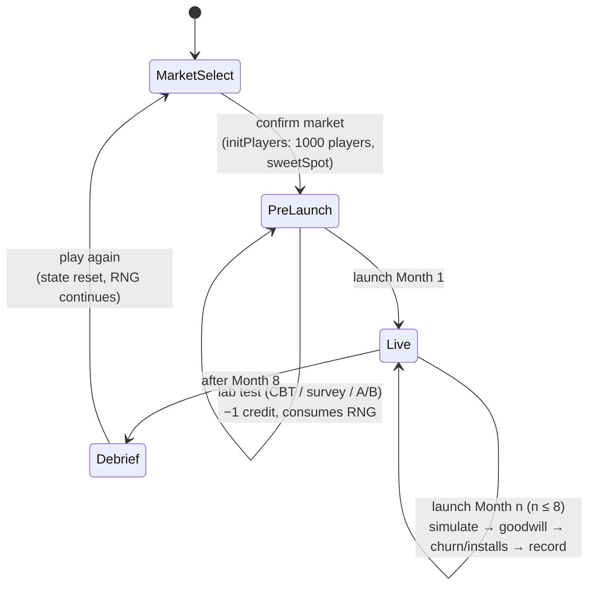
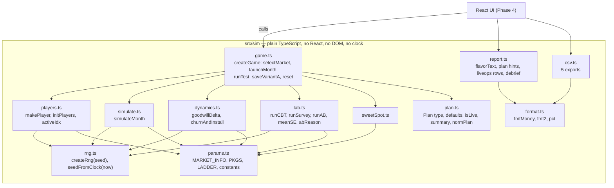

# Phase 3 — Simulation engine: dependency map, architecture, verification

The reference implementation is the Simulation script in `legacy/index.html`, lines 1184–1757
(one IIFE, ~570 lines). Line numbers below refer to that file. It is never edited: a test
(`tests/sim/legacyGuard.test.ts`) fails if its bytes change.

## 1. Dependency map (original code)

| # | Concern | Original functions / data (lines) | Inputs | Outputs | State mutated | Side effects |
|---|---|---|---|---|---|---|
| 1 | Market selection & parameters | `MARKET_INFO` (1188), market radio + `#market-confirm-btn` handler (1745) | chosen market | `state.market`, `state.sweet`, initial players | `state.market`, `state.sweet`, `players`, `nextId` | DOM: hides market panel, writes sweet-spot note |
| 2 | Population & segmentation | `makePlayer` (1223), `initPlayers` (1228), `activeIdx`, `population` (1229–1230), `SEG`, `ENG` (1206–1207) | market, install month, RNG | player objects | `players`, `nextId` | — |
| 3 | Monetization configuration | `PKGS`, `LADDER` (1195–1202), `readPlan` (1248), `isLive`, `planIsValid`, `planSummary` (1259–1266), `normPlan` (1417), `applyPlan`, reset/copy-last (1373, 1410–1414) | DOM controls | plan object | — | **reads the DOM** |
| 4 | Deterministic purchases | inside `simulate` (1295–1301): choice-overload `0.93^(n−6)`, pass `valueBonus`, highest affordable tier | plan, player budget/interest | spend per package | result accumulators | — |
| 5 | Gacha & pity | inside `simulate` (1302–1310), `PITY = 50`; expected-cost hint (1400) | pull price, odds %, budget, `gachaAffinity` | pulls, won, spend | result accumulators | — |
| 6 | Revenue | `simulate` (1269–1322) | plan, event flag, streak, cohort, `withDays` | `byPkg`, `buys`, `revenue`, `payers`, `perPlayer`, `txns`, `rows`, `daily` | none (returns result) | reads global `state.market`, `players` |
| 7 | Goodwill & retention | `goodwillDelta` (1325), `churnAndInstall` (1336) | plan, event flag, goodwill, payer set | delta; churned / installs | `players` (active flag, churnMonth, new players) | reads `state.round`, `state.eventStreak` |
| 8 | Daily & monthly progression | `#launch-btn` handler (1561–1603) | plan, event checkbox | `state.history[]`, `daily`, `panel`, `txns`, totals | almost all of `state`, `players` | DOM: log, LiveOps, HUD; `setTimeout(endGame)` after month 8 |
| 9 | Random numbers | `rngSeed`, `rand`, `randRange`, `shuffle` (1209–1212) | — | uniform (0,1) | `rngSeed` | **seed from `Date.now()`** |
| 10 | A/B testing & lab | `RUNNERS.cbt/survey/ab` (1482–1513), `meanSE` (1323), `cohortOf` (1469), `abState` (1418), `askConfirm` (1470), save-A (1517) | plan, variant A, credits | lab results | `state.credits`, `state.tests`, `state.variantA`, `state.pending` | DOM: confirm box, result cards |
| 11 | Reporting metrics | LiveOps (1547), `sparkline` (1536), `flavorText` (1526), `endGame` (1662), plan hints in `refreshPlanUI` (1382) | `state` | tables, grade, debrief text | — | DOM |
| 12 | CSV export | `csvCell`, `toCSV`, `monthsCSV`, `dailyCSV`, `panelCSV`, `txnCSV`, `testsCSV`, `download`, `copyText` (1605–1659) | `state` | 5 CSV strings | — | Blob download / clipboard |
| 13 | Reset & replay | `resetGame` (1731), `newState` (1219) | — | fresh state | `state`, `players` | DOM reset. **RNG is not reseeded** — the stream continues |

### How they depend on each other



### Game state transitions



### One month, in RNG order

The order in which random numbers are drawn **is part of the behaviour**: same seed + same
order = same game. The engine copies this order exactly.

1. `simulate`: monthly shock; then for each player: active days (30 draws, if `withDays`), budget noise,
   shuffle of offered packages, then per package: WTP noise, conversion draw (fixed price) or chase
   threshold + pulls (gacha), purchase day (if `withDays`).
2. `goodwillDelta`: one noise draw.
3. `churnAndInstall`: one draw per active player, one for the install count, then each new player.

## 2. Target architecture



**Why this shape**

- *Context object instead of globals.* The original keeps `state`, `players`, `nextId` and `rngSeed`
  in closure variables that every function reads. The engine passes one `Game` object explicitly,
  so two games (e.g. a test and the UI) can never interfere.
- *Plan as data.* The original reads checkboxes inside `readPlan()`. The engine receives a `Plan`
  object; the React UI will own the controls.
- *Clock behind an adapter.* `seedFromClock(Date.now())` reproduces the original seed rule
  `(now % 2147483646) + 1`; tests pass a fixed seed instead.
- *No new packages.* Only Vitest and jsdom, already installed in Phase 2.

## 3. Verification method

`tests/sim/legacyHarness.ts` loads **the unmodified** `legacy/index.html` into jsdom, fixes
`Date.now()` so the original seed is known, and drives the original page by clicking its real
buttons. CSV downloads are captured from the page's own `download()` call. The engine is then run
with the same seed and the same actions, and the outputs are compared **byte for byte**.

The expected values therefore always come from the original code, never from the new engine.

## 4. Test inventory and results

| File | What it proves | Tests |
|---|---|---|
| `tests/sim/legacyGuard.test.ts` | The reference is byte-identical to the live site (git blob `06378f0`); the harness controls the original seed | 2 |
| `tests/sim/equivalence.test.ts` | Original vs engine, same seed + same clicks: all 5 CSVs byte-identical, HUD, LiveOps rows, month log, plan hints, A/B availability, lab result cards, debrief (grade, stats, shares, every paragraph) | 23 |
| `tests/sim/fixtures.test.ts` + `fixtures/baseline-hashes.json` | SHA-256 of the original's exports for 3 scenarios, stored; the engine and the original both still reproduce them | 6 |
| `tests/sim/boundaries.test.ts` | Each rule in isolation with a fixed-value RNG: choice overload 6 vs 7 tiers, pass value bonus capped by budget, zero active days, pity at exactly 50, early win, budget-limited chase, chase threshold, goodwill terms, churn hazard at goodwill 59/60/80/81, payer 0.7×, installs at 30/70/80, sweet spots | 14 |
| `tests/sim/rng.test.ts` | Park–Miller published check value (seed 1 → 1043618065 after 10,000 draws), clock seed rule, invalid seeds | 4 |
| `tests/sim/independence.test.ts` | `src/sim` has no React / DOM / clock / `Math.random`; a full game runs in plain Node; games don't share state | 3 |
| `tests/sim/findings.test.ts` | Measures findings F1 and F3 (below) without changing anything | 5 |

**Equivalence scenarios** (each runs on the original page and on the engine):

1. US, default shop, 8 months, no tests: deterministic only.
2. VN, full 8-tier skin ladder (choice overload) + battle pass, CBT + survey, events in months 1–3 (fatigue streak).
3. JP, gacha boundaries: 1% odds at $0.50 (pity at 50 reached), 15% odds at $10 (early wins), then a mixed shop. The test also asserts that the pity, budget-limited and early-win paths were actually exercised.
4. CN, all 5 packages (crowding, pay-to-win): A/B refused when B = A, A/B pre-launch, A/B after month 2, CBT refused after launch.
5. ID, gacha only, $10 pulls, survey on a gacha-only shop.
6. US, empty shop: launch does nothing, CBT refused without spending a credit.
7. Reset: a full game, "Play again", a second full game in JP. Shows that the RNG continues across games and credits reset.
8. VN, exports compared after every month (checkpoints).
9–23. Matrix: all 5 markets × seeds 2, 1,000,003 and 2,147,483,646 (largest valid seed), mixed shop with an event month.

**Can the tests detect mistakes?** Before committing, I deliberately planted errors in the engine and ran the suite:
- payer churn factor 0.7 → 0.75: 21 of 23 scenarios failed;
- drawing engagement before budget (same maths, different random order): 23 of 23 failed;
- a change of one part in 10⁷ (0.7 → 0.7000001): 0 failed. It didn't flip a single random comparison, so the outcome really was identical.

All planted errors were reverted.

## 5. Findings about the original model (documented, NOT changed)

None of these were "fixed". The engine reproduces the original exactly. Each needs your decision.

| # | Finding | Where | Impact | Type |
|---|---|---|---|---|
| F1 | **Expected pulls ignore the pity cut-off.** The model uses `min(1/p, 50)`; with a hard pity at 50 the exact expectation is `(1 − (1 − p)⁵⁰) / p`. | `:1303` (purchase decision), `:1400` (hint shown to the player) | Overstates the expected cost of a win by **+27% at 1% odds**, +8% at 5%, ~0% at 15%. The chase threshold is stricter than the stated logic at low odds, and the on-page hint overstates the cost. Measured in `findings.test.ts`. | Mathematical approximation |
| F2 | **Pity resets every month.** Pull counts don't carry over between months or across banners. | `:1306-1308` | Real pity systems carry over (Where Winds Meet's 150-pull guarantee is shared across banners). The model understates how much a guarantee helps repeat spenders. | Model assumption |
| F3 | **Sweet-spot text rounds to whole dollars.** `price.toFixed(0)`. | `:1750`, `:1678` | Vietnam shows "$7" while the engine value and your honesty note (`:990`) say $6.50; Indonesia shows "$2" for $1.50. Display only. | Display inconsistency |
| F4 | **The event "pull-forward" finding is partly built in.** An event multiplies the *whole month's* budget, then 60% of purchases are assigned to days 1–7. Later weeks of event months therefore get fewer purchases by construction. | `:1272`, `:1287`, debrief `:1690-1693` | The debrief sentence "spending was pulled forward" describes the day-assignment rule, not a separately modelled substitution over time. Worth stating if you discuss event lift in the report. | Interpretation caution |
| F5 | **Once a player starts a gacha chase, they can spend past their WTP.** WTP only gates *starting*; pulls continue until a win, the pity or the budget limit. | `:1304-1308` | A deliberate sunk-cost escalation assumption. It raises gacha revenue relative to a WTP-capped model. Should be stated as an assumption. | Model assumption |
| F6 | **CBT 95% range uses a normal approximation** on highly skewed spend with n = 150. | `:1484-1486` | The range can be misleading. The page already says "treat this as a direction". | Statistical limitation |
| F7 | **Survey percentiles use the lower nearest rank**, `floor(f × (n − 1))`. | `:1495` | Slight downward bias in reported percentiles. Negligible. | Minor |
| F8 | **Grade baseline uses a fixed 200,000 population** and the deterministic sweet-spot revenue. Thresholds (3.7 / 3.1 / 2.4 / 1.3) are calibration choices. | `:1667-1669` | The grade is a teaching device, not a statistic. | Model assumption |
| F9 | **"Save Variant A" says "Free" but is disabled at 0 credits.** | `:1452`, `:1455` | UI inconsistency. The engine preserves it (`saveVariantA` refuses at 0 credits). | UI |

## 6. Behavioural differences

**None in model output.** For every scenario above, all exports, numbers and texts are identical.

Differences in *structure* (not behaviour):
- The seed is a parameter (`createGame(seed)`). The live UI will call `seedFromClock(Date.now())` to keep the original rule.
- The plan is passed in as data, not read from checkboxes. Tiers are sorted ascending, as `readPlan()` did.
- The confirm-box state (`state.pending`) and all HTML are UI concerns and are not in the engine. The debrief's links ("Diagnostic page", "Industry page") are plain text there. The React UI will add the links.
- Refusals for buttons the original simply disabled get a short reason (`'Pre-launch only.'`, `'No test credits left.'`) so the UI can explain them.
- The engine's CSV builders take the state as an argument; file names are unchanged (`payorpray_<market>_<kind>.csv`).

## 7. Known limitations of the verification

- The equivalence tests run the original in jsdom with the same JavaScript engine (V8) as the new code. Both use `Math.log`, `Math.exp`, `Math.pow` and `toLocaleString('en-US')`, which could in principle differ between browsers. The original has the same exposure, so this isn't a migration risk.
- Equivalence covers the UI's legal ranges (pull $0.50–$10 in $0.50 steps, odds 1–15%), because the original sliders refuse other values. Outside those ranges the engine applies the same formulas, but there's no original output to compare against.
- Clipboard "Copy monthly KPIs" isn't driven in jsdom; it copies the same text as `monthsCSV`, which is verified.
- The Industry/translation scripts on the legacy page run in English only during tests (translations aren't loaded).

## 8. Rollback

The Phase 3 commit only *adds* files (`src/sim/`, `tests/sim/`, this document); no existing file is modified. To undo it without touching anything else:

```bash
git revert <phase-3-commit-hash>
```

This creates a new commit that removes Phase 3 and keeps history intact. Nothing else on the site depends on `src/sim` yet.
